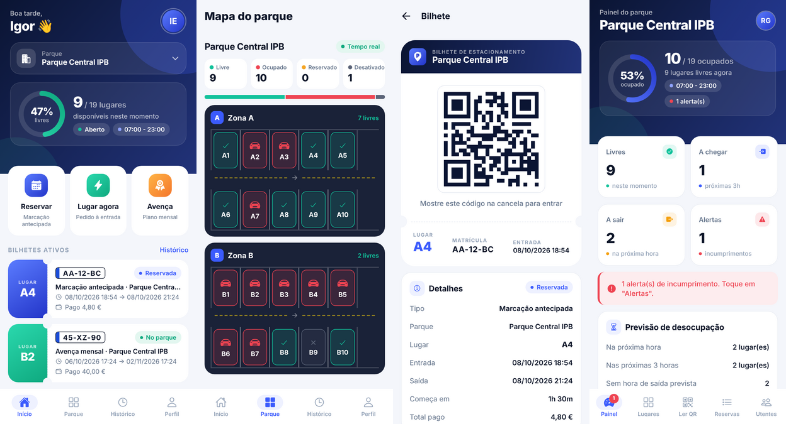

# ParkSmart — App de gestão de um parque de estacionamento inteligente

Projeto de **Desenvolvimento Multiplataforma** (LEI 2026/2027, turno C).
App mobile em **React Native (Expo SDK 57, TypeScript)** com **Firebase** (Authentication, Cloud Firestore e, opcionalmente, Storage), como exige o RNF1.



> Branch a avaliar: `main`. As versões avaliadas são marcadas com as tags `Figma`, `Componentes`, `Backend` e `Final`.

---

## 1. Como executar

### Requisitos
- Node.js 20+ e npm
- Telemóvel com a app **Expo Go** (SDK 57) ou um emulador Android/iOS
- Um projeto Firebase (plano gratuito Spark chega)

### Configuração automática (recomendado)
Um único comando faz tudo: login no Firebase, cria o projeto e a Web app, escreve o `.env`, cria o Firestore e publica as regras, ativa o login por Email/Password, cria o parque e o administrador e envia o código para o GitLab com as tags.

```bash
npm install
npm run setup -- --park "Parque Central" --email admin@parque.pt --password admin123 --demo \
  --gitlab https://gitlab.estig.ipb.pt/<grupo>/<projeto>.git --tags Final
```
- Precisa do **git**; o **gcloud** (Google Cloud CLI) é opcional mas evita dois passos manuais (ativar Email/Password e gerar a chave de serviço). Sem ele, o script mostra os links e espera.
- O que não for passado como opção é perguntado. `--project <id>` reutiliza um projeto Firebase existente; `--skip-firebase` faz só o envio para o GitLab.
- O browser abre para os logins (Firebase/Google) e o git pede as credenciais do GitLab (utilizador + password ou token de acesso pessoal).

### Configuração manual
1. **Instalar dependências**
   ```bash
   npm install
   ```
2. **Criar o projeto Firebase** em <https://console.firebase.google.com>:
   - *Authentication* → ativar o método **Email/Password**;
   - *Firestore Database* → criar a base de dados;
   - *Definições do projeto* → *As suas apps* → adicionar uma **Web app** e copiar a configuração.
3. **Configurar o `.env`**
   ```bash
   cp .env.example .env
   ```
   e preencher as variáveis `EXPO_PUBLIC_FIREBASE_*` com a configuração da Web app.
4. **Publicar as regras de segurança** (Firebase CLI):
   ```bash
   npm i -g firebase-tools
   firebase login
   firebase use --add          # escolher o projeto
   firebase deploy --only firestore:rules,firestore:indexes
   ```
   (Em alternativa, copiar o conteúdo de `firestore.rules` para a consola, separador *Regras*.)
5. **Criar o parque e o administrador** (RFA0 — o administrador é registado diretamente na base de dados):
   - Consola Firebase → *Definições do projeto* → *Contas de serviço* → **Gerar nova chave privada** e guardar como `scripts/serviceAccount.json` (está no `.gitignore`).
   - Correr:
     ```bash
     npm run seed -- --key scripts/serviceAccount.json \
       --email admin@parque.pt --password admin123 --name "Administrador" \
       --park "Parque Central" --zones A:12,B:12 --demo
     ```
     `--demo` cria também um gestor e um utente de teste (password `demo1234`; os emails aparecem no terminal).
     Pode correr o script várias vezes para criar vários parques (RNF0).
6. **Arrancar a app**
   ```bash
   npx expo start
   ```
   e ler o QR Code com a Expo Go (Android) ou com a câmara (iOS).

### Scripts úteis
| Comando | Descrição |
|---|---|
| `npm start` | Arranca o Metro / Expo |
| `npm run typecheck` | Verificação de tipos (TypeScript) |
| `npm test` | Testes unitários da lógica de negócio (preços, disponibilidade, horários, QR) |
| `npm run seed -- ...` | Cria um parque com lugares e o respetivo administrador |

### Notas
- **Fotos de perfil**: por omissão são guardadas comprimidas (base64) no documento do utilizador, porque o Firebase Storage exige agora o plano Blaze. Com Storage disponível, pôr `EXPO_PUBLIC_USE_STORAGE=true` e publicar `storage.rules` (`firebase deploy --only storage`).
- **Notificações**: as notificações locais (geradas pelos listeners em tempo real) funcionam na Expo Go. O push remoto entre utilizadores (Expo Push) precisa de um *development build* e de `EXPO_PUBLIC_EAS_PROJECT_ID` (`npx eas-cli init`).
- **Pagamentos**: são simulados (o botão "Pagar" marca o valor como pago); não há integração com um gateway de pagamento.

---

## 2. Perfis e funcionalidades

### Utente
| Requisito | Onde |
|---|---|
| **RFC0** Registo e autenticação; perfil; histórico por veículo com valores pagos | `RegisterScreen`, `LoginScreen`, `HistoryScreen` (agrupado por matrícula com total pago) |
| **RFC1** Marcação antecipada: tipo + matrícula + dias → lugar + QR (entrada/saída) + confirmação e valor; alteração até à data de saída se o lugar estiver vago | `ReserveScreen`, `ReservationDetailScreen`, `services/reservations.ts` (`createReservation`, `editReservation`) |
| **RFC2** Lugar no momento da entrada: lugar atribuído automaticamente, sem alteração; valor notificado à saída | `WalkInScreen`, `utils/availability.ts` (`pickSpotForWalkIn`), `services/gate.ts` |
| **RFC3** Comprar e renovar avença mensal (período fixo = mês civil), sempre o mesmo QR | `ReserveScreen` (modo avença), `renewMonthly` |
| **RFC4** Ver lugares vagos para o período pedido e escolher na vista virtual do parque | componente `ParkMap` dentro de `ReserveScreen` |
| **RFC5** Alterar nome, telemóvel, foto e password | `ProfileScreen` |

### Segurança / Gestor
| Requisito | Onde |
|---|---|
| **RFG0** Conta criada pelo administrador | `CreateAccountScreen` |
| **RFG1a** Editar estado do lugar (ativo/desativo, ocupado/desocupado) | `StaffParkScreen` (tocar num lugar) |
| **RFG1b** Ocupação com previsão de desocupação | `DashboardScreen` |
| **RFG1c / RFG5** Estatísticas de ocupação e funcionamento | `StatsScreen` (`utils/stats.ts`) |
| **RFG2a/b** Validar registos, editar utentes, editar o próprio perfil | `UsersScreen`, `UserEditScreen`, `ProfileScreen` |
| **RFG3** Todos os lugares reservados e viaturas no parque | `ReservationsScreen` (filtros "No parque" / "Reservas") |
| **RFG4** Vista virtual com ocupados, vazios e desativados | `StaffParkScreen` (com hora prevista de saída em cada lugar) |
| **RFG6** Alertas de incumprimento, alterar reservas, emitir pagamentos extra | `AlertsScreen`, `ManageReservationScreen`, `utils/alerts.ts` |
| Leitura de QR na cancela | `ScanScreen` (câmara + alternativa por matrícula) |

### Administrador
| Requisito | Onde |
|---|---|
| **RFA0** Registo direto na base de dados | `scripts/seed.mjs` |
| **RFA1** Nome do parque, lugares (espaços úteis) e horário; reservas limitadas ao horário | `ParkSettingsScreen`, `validateOpeningHours` |
| **RFA2** Gerir utentes e seguranças/gestores | `UsersScreen` (separador "Contas"), `CreateAccountScreen` |
| **RFA3** Veículos estacionados e que alguma vez usaram o parque | `VehiclesScreen`, `VehicleHistoryScreen` |
| **RFA4** Preços por hora e das avenças | `PricesScreen` |
| **RFA5** Reset do histórico de reservas | `ResetHistoryScreen` |

### Requisitos não funcionais
- **RNF0 — vários parques**: cada parque é um documento em `parks/`; gestores e administradores pertencem a um parque; o utente escolhe o parque no início (`ParkSelector`, `ParkContext`).
- **RNF1 — React Native + Firebase**.

### Pontos de avaliação
- **Dois (três) tipos de navegação**: *Native Stack* na raiz + *Bottom Tabs* distintos por perfil (`src/navigation`), mais *modais* (seletor de parque, folha de ações).
- **Componentes reutilizáveis**: `ParkMap`, `ReservationCard`, `VehiclePicker`, `DateTimeField`, `QRTicket`, `BarChart`, `AppButton`, `TextField`, etc. (`React.memo` nas células do mapa e nos cartões; `FlatList`/`SectionList` nas listas).
- **Sincronização entre vistas e utilizadores**: tudo é lido com `onSnapshot` (`hooks/useFirestore.ts`); por exemplo, quando o gestor lê o QR na cancela, o bilhete do utente, a vista do parque e o painel atualizam-se em tempo real. A entrada/saída é feita numa *transaction* (`services/gate.ts`).
- **Componentes técnicos avançados**: leitura de QR Codes (`expo-camera`), geração de QR (`react-native-qrcode-svg`), upload de fotos (`expo-image-picker` + Storage/base64), notificações locais agendadas e push remoto (`expo-notifications` + Expo Push).

---

## 3. Fluxo de uma reserva

```
utente cria reserva ──► reservada ──(QR lido na cancela)──► no_parque ──(QR lido à saída)──► concluida
                            │                                                    │
                            └─► cancelada                     avença: volta a "reservada" até ao fim do mês
```
- **Antecipada**: paga na confirmação; à saída, se exceder a hora (tolerância de 10 min) é emitido um pagamento de "tempo excedido".
- **Na hora**: sem hora de saída; o valor é calculado à saída e o utente é notificado.
- **Avença**: entra e sai as vezes que quiser durante o mês com o mesmo QR.
- **Preço**: cada hora iniciada ao preço/hora do tipo de veículo, com um máximo diário por cada 24h.
- **Alertas** (RFG6): não comparência (30 min após o início), tempo excedido e pagamentos em falta.

## 4. Modelo de dados (Firestore)

```
parks/{parkId}                 name, address, open24h, openTime, closeTime, prices{hourly,daily,monthly}
parks/{parkId}/spots/{id}      code, zone, order, active, occupied
parks/{parkId}/bookings/{id}   spotId, start, end, status   ← espelho público das reservas (sem dados pessoais)
parks/{parkId}/vehicles/{mat}  plate, vehicleType, visits, firstSeen, lastSeen, lastUserName
users/{uid}                    name, email, phone, photoURL, role, status, parkId, vehicles[], pushToken
reservations/{id}              parkId, userId, kind, spotId, plate, start, end, status, qrToken, payments[], entries[]
```
A coleção `bookings` permite a qualquer utente calcular os lugares livres sem poder ler as reservas (matrículas, nomes) dos outros utentes. As regras em `firestore.rules` garantem que cada perfil só faz o que lhe compete.

## 5. Estrutura do projeto

```
App.tsx                 providers + navegação
src/
  config/firebase.ts    inicialização do Firebase (auth persistente com AsyncStorage)
  context/              AuthContext (sessão + perfil em tempo real), ParkContext (parque atual)
  hooks/                useQueryData/useDocData (onSnapshot), hooks de dados, notificações
  services/             auth, users, parks, reservations, gate (cancela), notifications
  utils/                lógica pura e testada: preços, disponibilidade, datas, alertas, estatísticas, QR
  theme/                design system (cores, degradês, tipografia, sombras)
  components/           componentes reutilizáveis (Logo, HeroHeader, AppButton, ParkMap, QRTicket...)
  navigation/           Stack raiz + Tabs por perfil
  screens/              auth/, common/, utente/, gestor/, admin/
scripts/seed.mjs        criação de parque + administrador (Firebase Admin SDK)
scripts/brand-assets.mjs  gera ícones e splash a partir do logótipo
firestore.rules         regras de segurança
```

### Identidade visual e design system

- **Logótipo**: pino de localização com um "P" sobre um azulejo em degradê índigo (`src/components/Logo.tsx`, SVG em `design/brand/`). O ícone da app, o ícone adaptativo do Android, o favicon e o splash são gerados com `node scripts/brand-assets.mjs` (usa o Playwright/Chromium para rasterizar o SVG).
- **Paleta** (`src/theme`): índigo `#3B5BFD` (marca), azul-noite `#0B1533` (cabeçalhos e splash), menta `#12C29B` (livre/sucesso), âmbar (reservado) e coral (ocupado/erro), com neutros em ardósia.
- **Tipografia**: Inter (400 a 800) carregada com `expo-font`; o splash fica visível até as fontes estarem prontas.
- **Componentes**: botões em degradê com feedback tátil, campos com ícone e estado de foco, cartões com sombra suave, cabeçalho `HeroHeader`, anel de ocupação, bilhete com QR Code e mapa do parque desenhado como asfalto com marcações.

Capturas de ecrã em `design/redesign/`.

## 6. Teste rápido do fluxo completo
1. Entrar como **utente** → *Reservar* → escolher veículo, período e um lugar verde no mapa → *Confirmar e pagar*. Aparece o bilhete com o QR.
2. Noutro telemóvel (ou depois de terminar sessão) entrar como **gestor** → *Ler QR* → apontar para o QR do utente: entrada registada. O lugar fica vermelho na vista do parque e o utente recebe a notificação.
3. Ler o QR outra vez → saída registada (se for "Lugar agora", o utente é notificado do valor e paga no bilhete).
4. Criar uma conta nova de utente → aparece em *Utentes → Pendentes* do gestor para validar.
