# ParkSmart — Relatório da 2.ª entrega (Componentes)

- **Unidade curricular:** Desenvolvimento Multiplataforma — LEI 2026/2027, turno C
- **Projeto:** App para gestão de um parque de estacionamento inteligente
- **Grupo:** _[nomes e números dos elementos do grupo]_
- **Repositório GitLab:** _[colar aqui o link do projeto no GitLab]_
- **Branch avaliada:** `main` · **Tag:** `Componentes`

---

## 1. Objetivo da entrega

Nesta entrega apresentamos a implementação dos ecrãs e dos componentes gráficos da aplicação, ligados a estruturas de dados locais, de forma a demonstrar todas as funcionalidades sem depender de um servidor. A app arranca, por omissão, em **modo local**: os parques, lugares, utilizadores, reservas, pagamentos e veículos ficam numa base de dados guardada no próprio telemóvel e já preenchida com dados de demonstração.

A app é desenvolvida em **React Native (Expo SDK 57) com TypeScript**. A ligação ao Firebase (RNF1), prevista para a entrega *Backend*, já está preparada e ativa-se apenas com uma variável de configuração (`EXPO_PUBLIC_DATA_MODE=firebase`), sem alterar os ecrãs.

## 2. Como executar

```bash
npm install
npx expo start      # ler o QR Code com a app Expo Go
```

No ecrã de entrada existem atalhos para as contas de demonstração:

| Perfil | Email | Password |
|---|---|---|
| Utente | utente@parque.pt | demo1234 |
| Segurança / Gestor | gestor@parque.pt | demo1234 |
| Administrador | admin@parque.pt | admin123 |

Há ainda outros utentes (dois com o registo por validar e um bloqueado), um segundo gestor e um segundo parque com o respetivo administrador. Em *Perfil → Repor dados iniciais* é possível voltar ao estado inicial a qualquer momento.

## 3. Arquitetura

```
ecrãs (src/screens)  →  componentes (src/components)
        │
        ▼
hooks de dados (src/hooks)  ──  onSnapshot: atualização em tempo real das vistas
        │
        ▼
serviços / regras de negócio (src/services, src/utils)
        │
        ▼
camada de dados (src/data/db.ts, src/data/auth.ts)
        ├── modo local:    src/data/local  (base de dados no dispositivo + AsyncStorage)
        └── modo firebase: Cloud Firestore + Firebase Authentication
```

- **Navegação (dois tipos):** um *Native Stack* na raiz para formulários e detalhes (nova reserva, bilhete, gerir reserva, editar utente, configurações) e *Bottom Tabs* diferentes para cada perfil (utente, gestor e administrador).
- **Estado global:** `AuthContext` (sessão e perfil do utilizador, ouvido em tempo real) e `ParkContext` (parque selecionado, RNF0).
- **Regras de negócio puras e testadas** em `src/utils`: cálculo de preços, disponibilidade de lugares, horários de funcionamento, alertas de incumprimento, estatísticas e QR Codes.

## 4. Estruturas de dados locais

A base de dados local (`src/data/local/store.ts`) guarda documentos organizados em coleções, com o mesmo modelo que será usado no Firestore:

| Coleção | Conteúdo |
|---|---|
| `parks/{parque}` | nome, morada, horário de funcionamento e tabela de preços (hora, teto diário, avença) |
| `parks/{parque}/spots` | lugares: código, zona, ativo/desativo, ocupado/livre |
| `parks/{parque}/bookings` | ocupação pública de cada lugar (sem dados pessoais), usada para calcular os lugares vagos |
| `parks/{parque}/vehicles` | todos os veículos que já usaram o parque (n.º de entradas, primeira e última visita) |
| `users/{uid}` | perfil: nome, email, telemóvel, foto, papel, estado da conta, parque e veículos |
| `reservations/{id}` | reserva: tipo, lugar, matrícula, período, estado, token do QR, pagamentos e entradas/saídas |

Características principais:

- **Mesma interface do Firestore:** `collection`, `doc`, `query/where`, `getDoc(s)`, `setDoc`, `updateDoc`, `writeBatch`, `runTransaction` e `onSnapshot`. Os serviços e os ecrãs usam o mesmo código nos dois modos; a escolha é feita num único ponto (`src/data/db.ts`).
- **Persistência:** cada alteração é gravada em JSON com o AsyncStorage, por isso os dados (e a sessão iniciada) mantêm-se depois de fechar a app.
- **Escritas atómicas:** um *batch* ou uma transação aplica todas as alterações ou nenhuma. Por exemplo, a leitura do QR na cancela atualiza a reserva, o lugar e o registo de veículos de uma só vez.
- **Sincronização entre vistas:** sempre que os dados mudam, todos os ecrãs abertos que dependem deles são atualizados automaticamente (mapa do parque, painel do gestor, bilhete do utente, alertas).
- **Contas locais:** a autenticação de demonstração (`src/data/local/auth.ts`) usa os mesmos códigos de erro do Firebase Auth, por isso as mensagens mostradas são as mesmas nos dois modos.
- **Dados de demonstração** (`src/data/local/seed.ts`): gerados em relação à hora atual, para que existam sempre veículos dentro do parque, reservas futuras, uma avença ativa, histórico das últimas duas semanas e os três tipos de alerta.

A camada local tem 8 testes automáticos (consultas, escritas atómicas, transações, notificação das vistas, persistência e autenticação), que se somam aos 9 testes das regras de negócio (`npm test`).

## 5. Componentes gráficos reutilizáveis

| Componente | Utilização |
|---|---|
| `AppButton`, `TextField`, `Card`, `Badge`, `Banner`, `ListItem`, `Avatar` | base visual comum a todos os ecrãs (design system com paleta, tipografia Inter e espaçamentos definidos em `src/theme`) |
| `HeroHeader`, `Screen`, `Logo` | cabeçalhos e estrutura dos ecrãs |
| `ParkMap` | vista virtual do parque por zonas, com lugares livres, ocupados, reservados e desativados; seleção de lugar (utente) e edição do estado (gestor) |
| `ReservationCard`, `QRTicket`, `PaymentList` | bilhetes, QR Code de entrada/saída e lista de pagamentos |
| `VehiclePicker`, `DateTimeField`, `ParkSelector` | escolha do veículo, do período e do parque |
| `Charts` | gráficos das estatísticas (receita, entradas por hora, tipos de reserva) |
| `ActionSheet`, `DemoPanel` | menus de ações e atalhos/reposição dos dados de demonstração |

## 6. Funcionalidades implementadas

### Utente

| Requisito | Funcionalidade | Ecrã |
|---|---|---|
| RFC0 | Registo (fica pendente até validação), autenticação, perfil e histórico por veículo com os valores pagos | Registo, Entrada, Histórico |
| RFC1 | Marcação antecipada: tipo e matrícula do veículo, período, lugar e valor; bilhete com QR Code; alteração até à data de saída se o lugar continuar vago; cancelamento com reembolso | Nova reserva, Bilhete |
| RFC2 | Lugar no momento da entrada, atribuído automaticamente e sem alteração; valor calculado à saída | Lugar agora |
| RFC3 | Compra e renovação de avença mensal (mês civil), sempre com o mesmo QR Code | Avença, Bilhete |
| RFC4 | Lugares vagos para o período pedido na vista virtual do parque | Nova reserva, Mapa do parque |
| RFC5 | Alterar nome, telemóvel, foto e password | Perfil |

### Segurança / Gestor

| Requisito | Funcionalidade | Ecrã |
|---|---|---|
| RFG1a | Ativar/desativar e ocupar/libertar lugares | Lugares |
| RFG1b | Ocupação atual com previsão de desocupação | Painel |
| RFG1c, RFG5 | Estatísticas de ocupação e funcionamento | Estatísticas |
| RFG2 | Validar registos, editar ou bloquear utentes, editar o próprio perfil | Utentes, Conta, Perfil |
| RFG3 | Todas as reservas e todos os veículos dentro do parque | Reservas |
| RFG4 | Vista virtual com lugares ocupados, vazios e desativados | Lugares |
| RFG6 | Alertas de não comparência, tempo excedido e pagamento em falta; alterar reservas e emitir pagamentos extra | Alertas, Gerir reserva |
| — | Registo de entradas e saídas na cancela pela leitura do QR Code (câmara) ou pela matrícula | Ler QR |

### Administrador

| Requisito | Funcionalidade | Ecrã |
|---|---|---|
| RFA1 | Nome do parque, morada, horário de funcionamento (limita as horas das reservas) e gestão dos lugares por zonas | Configurar parque |
| RFA2 | Criar e gerir contas de utentes e gestores | Contas, Criar conta |
| RFA3 | Veículos estacionados e todos os que já usaram o parque, com histórico | Veículos |
| RFA4 | Preços por hora, teto diário e avenças por tipo de veículo | Preços |
| RFA5 | Reset do histórico de reservas (opcionalmente só antes de uma data) | Histórico de reservas |
| RNF0 | Vários parques: o utente escolhe o parque; gestores e administradores pertencem a um | Seletor de parque |

## 7. Ecrãs

<table>
<tr>
<td align="center">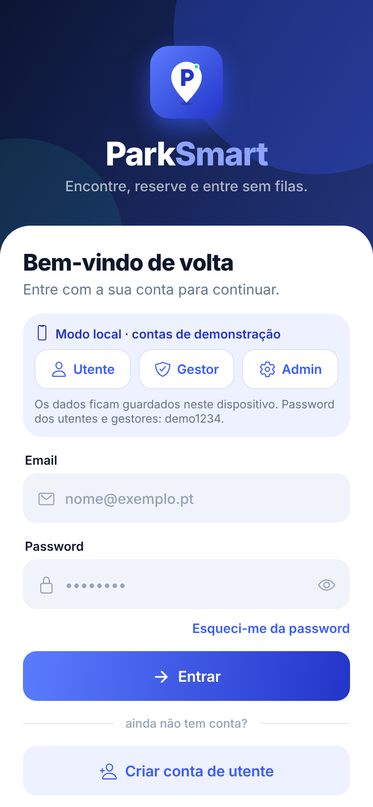<br>Entrada</td>
<td align="center">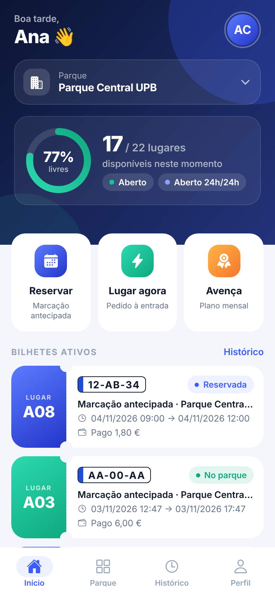<br>Início do utente</td>
<td align="center">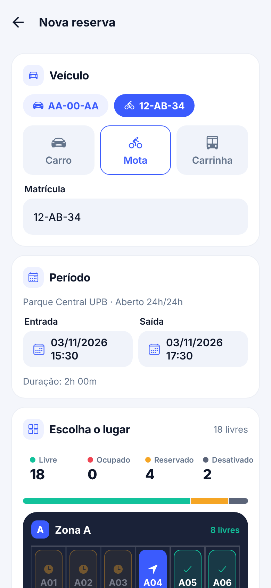<br>Nova reserva</td>
<td align="center">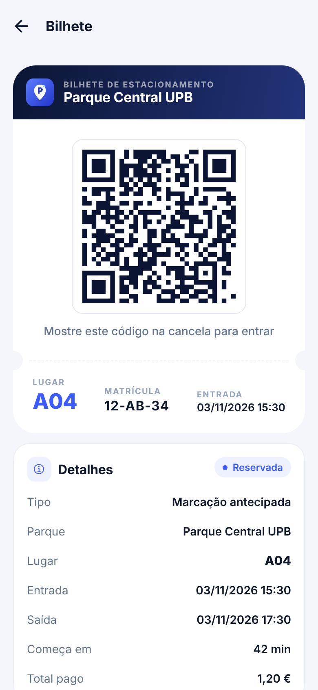<br>Bilhete com QR</td>
</tr>
<tr>
<td align="center">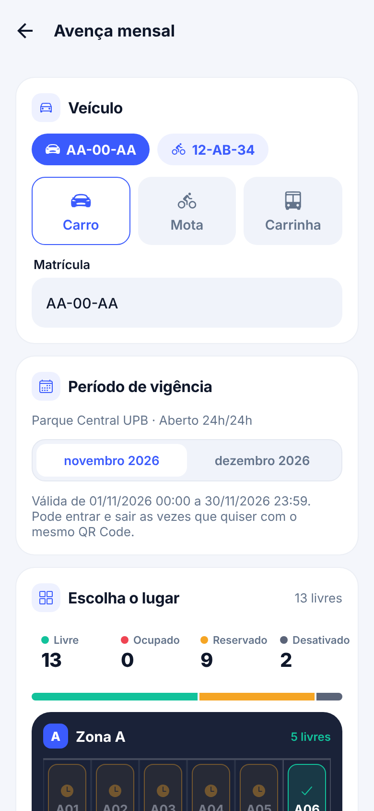<br>Avença mensal</td>
<td align="center">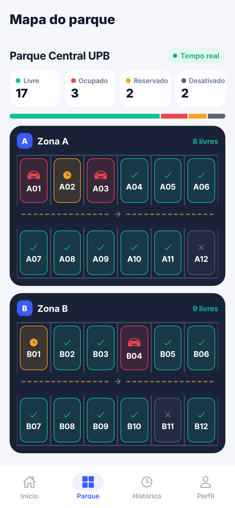<br>Mapa do parque</td>
<td align="center">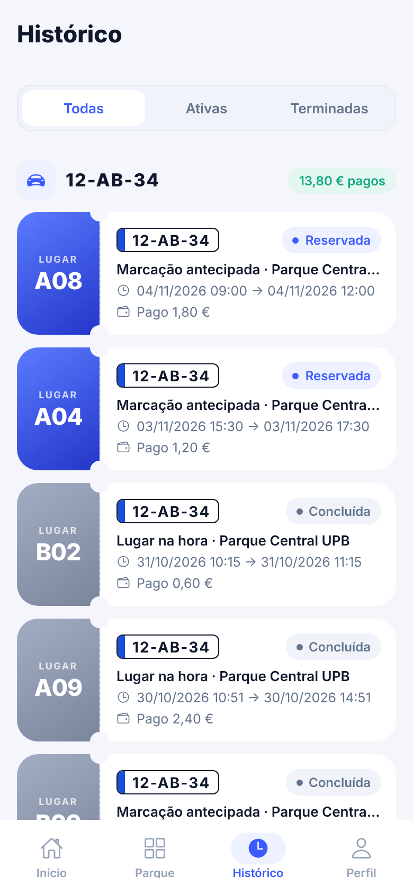<br>Histórico por veículo</td>
<td align="center">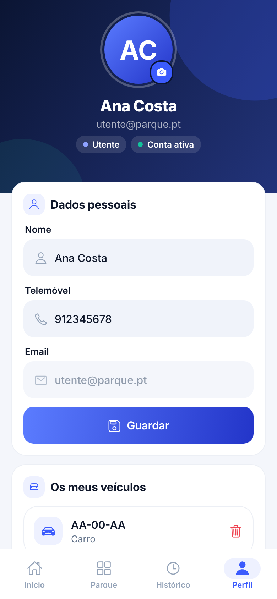<br>Perfil</td>
</tr>
<tr>
<td align="center">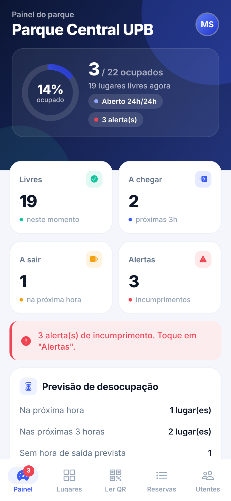<br>Painel do gestor</td>
<td align="center">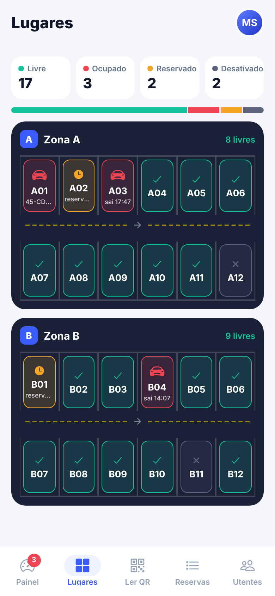<br>Gestão de lugares</td>
<td align="center">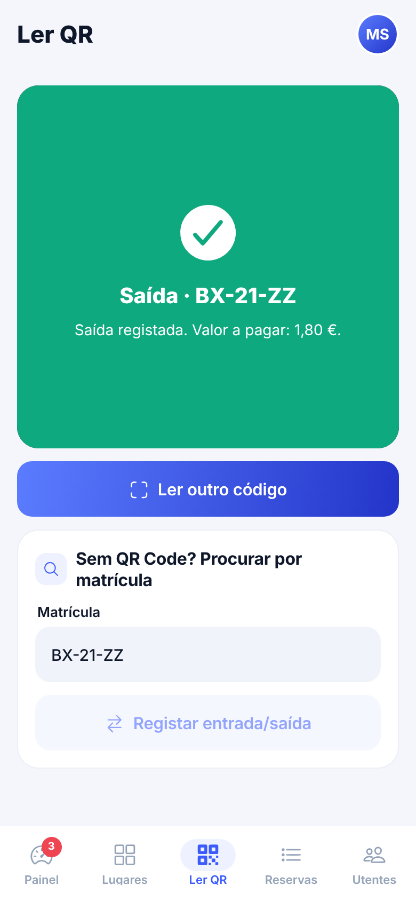<br>Saída na cancela</td>
<td align="center">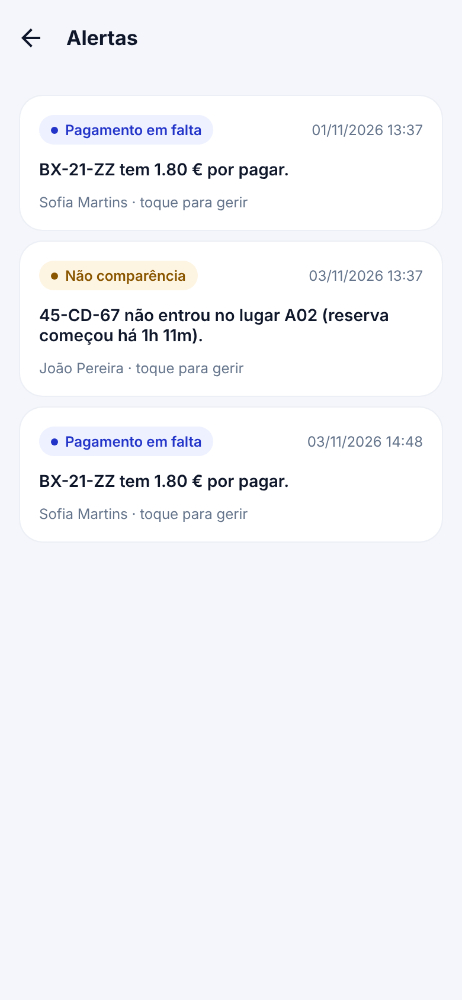<br>Alertas</td>
</tr>
<tr>
<td align="center">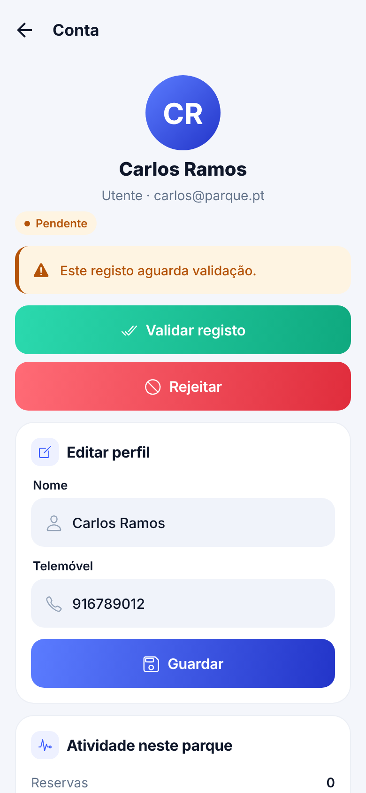<br>Validar utente</td>
<td align="center">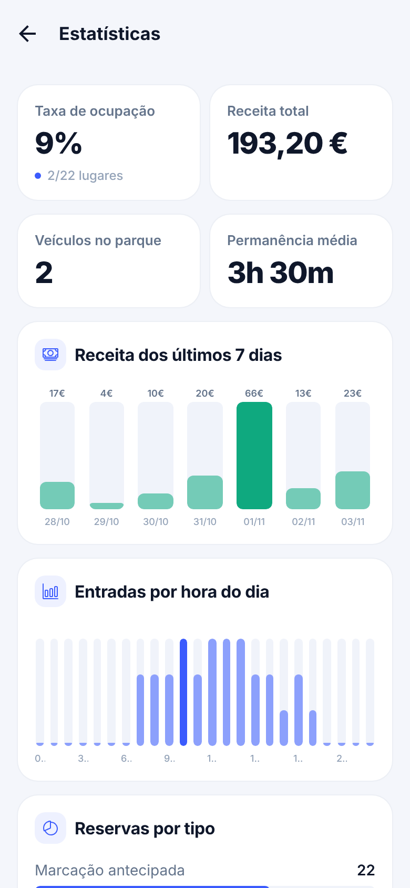<br>Estatísticas</td>
<td align="center">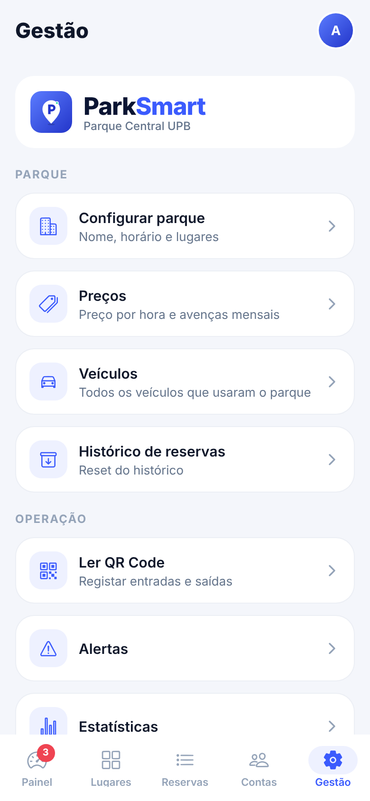<br>Gestão (admin)</td>
<td align="center">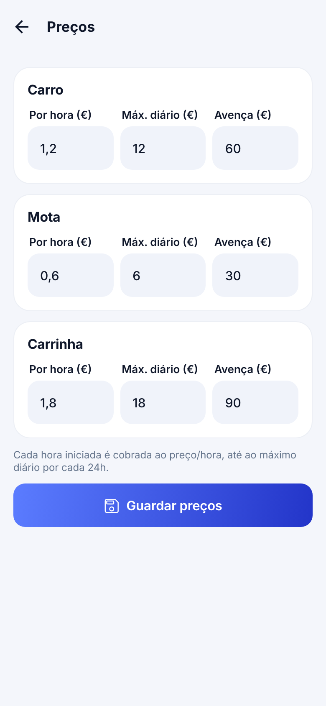<br>Preços</td>
</tr>
</table>

Todas as capturas (24) estão em [`docs/componentes/`](componentes/).

## 8. Próxima entrega (Backend)

Na entrega *Backend* a mesma app passa a usar o Cloud Firestore e o Firebase Authentication (`EXPO_PUBLIC_DATA_MODE=firebase`), com regras de segurança por perfil, sincronização entre utilizadores em dispositivos diferentes e notificações push. Como a camada de dados local tem a mesma interface, os ecrãs e os serviços não precisam de ser alterados.
